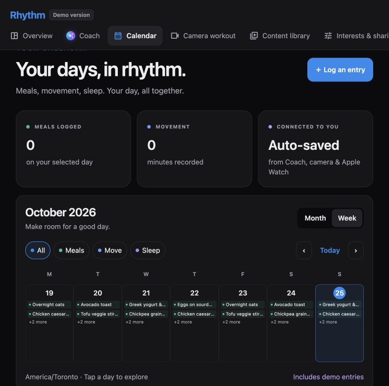
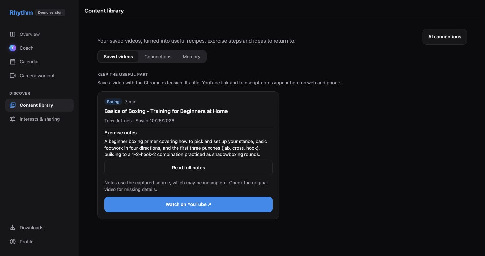
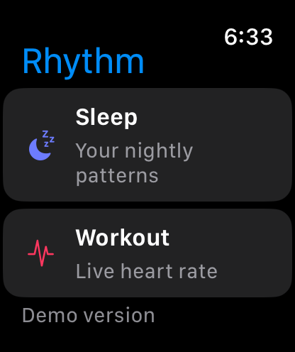

# Rhythm — Demo version

Your health, connected: meals, movement, saved video ideas and useful assistant context across your devices.

**[Open the live Rhythm demo](https://rhythm-buildnorth.expo.app)** · **[Download the apps and Chrome extension](https://rhythm-buildnorth.expo.app/downloads)**

Rhythm is a **demo version**. Sign in on the website to explore the Calendar, Coach, Content library and AI connections.
Shared Claude is included for the demo; you can also connect your own Claude API key or authorized assistants over MCP.

## What you can explore

- **Calendar:** a single timeline for meals and activity, Watch sleep/workout summaries when linked, and monthly reports. Sample entries are labeled and kept separate from real health totals.
- **Coach and memory:** account-scoped preferences and context through SurrealDB Agent Memory, with server-enforced user isolation.
- **Content library and Chrome extension:** save a selected YouTube video with its original link and turn an available captured transcript into cooking instructions, exercise steps or useful takeaways.
- **Website camera coach:** supported movement tracking, counted sets, prototype form feedback and 3D reference comparisons. Camera tracking runs in the browser; the pose service needs to be running.
- **Voice and assistant connections:** ElevenLabs agents and authorized ChatGPT/Claude MCP connections. The alternative Parakeet/Kokoro voice worker needs a separate deployment.

## Screenshots

Actual demo captures; the Calendar shown contains sample entries.

| Calendar | Saved video notes | Apple Watch simulator |
| --- | --- | --- |
| [](docs/images/rhythm-calendar.png) | [](docs/images/rhythm-content-library.png) | [](docs/images/rhythm-watch.png) |

## Download and demo availability

Use the [Downloads page](https://rhythm-buildnorth.expo.app/downloads) for the available packages and installation steps.

| Experience | Demo availability |
| --- | --- |
| Website | Live at [rhythm-buildnorth.expo.app](https://rhythm-buildnorth.expo.app) |
| Windows | x64 Windows 10 1809+ / Windows 11 test build; self-signed certificate and account sign-in |
| Android | ARM64 signed APK; emulator launch verified |
| Mac | Apple silicon app with local demo data; ad-hoc signed and not notarized |
| iPhone and Apple Watch | Apple silicon Xcode simulator packages; physical-device installation needs your own Xcode signing setup |
| Chrome extension | Prepared ZIP; unzip and load through Chrome Developer mode |

Simulator screenshots demonstrate the interface; real Watch heart-rate and sleep measurements require physical hardware.

## Repository layout

One repository, three app projects, a website and a Chrome companion:

| Folder | What | Guide |
|---|---|---|
| [`mobile/`](mobile/) | The Expo app (iPhone, Android, and an Apple Watch app in SwiftUI) plus the FastAPI backend in `mobile/backend/` | [mobile/README.md](mobile/README.md) |
| [`mac/`](mac/) | The native macOS app: React Native for macOS with parts of Expo SDK 55 (project name `NorthAssistant`) | [mac/README.md](mac/README.md) |
| [`win/`](win/) | The native Windows app: React Native for Windows with Expo SDK 56's tooling, ported from the Mac app; local demo data, or your account through the backend once signed in (project name `NorthAssistant`) | [win/README.md](win/README.md) |
| [`extension/`](extension/) | Rhythm, a Chrome side panel for phone-controlled video interests and user-chosen MCP agents | [extension/README.md](extension/README.md) (backend side: [Rhythm guide](mobile/docs/rhythm.md)) |
| [`inference/pose-coach/`](inference/pose-coach/) | Browser camera coach, embedded in the website; counted sets save to Activity | [Website integration](mobile/docs/pose-coach.md) |

How the mobile and Mac apps were built, what was checked and what is still open:
[mobile/docs/work-log.md](mobile/docs/work-log.md). The Windows app's equivalent is in [win/README.md](win/README.md).

Local standalone Release builds for iPhone/Watch simulators, Android, and Mac:
[build and testing guide](docs/local-release-builds.md). Packaged binaries and the local build catalog live in
ignored `artifacts/releases/<date>/`; no store submission is needed for computer testing.

## Quick start

Backend:

```bash
cd mobile/backend && .venv/bin/uvicorn app.main:app --host 0.0.0.0 --port 8000
```

iPhone, Android and watch (Metro on 8081):

```bash
cd mobile && npx expo start
```

React Native web app (same backend and Clerk account):

```bash
cd mobile && npm run web
```

Open `http://localhost:8081`. The website brings together Calendar, Coach, saved content, interests and sharing controls. Build a static export with `npm run build:web`.
See [web setup](mobile/README.md#web-app) for the extension link and cookie behavior.

Mac app (Metro on 8090, then build and open the app):

```bash
cd mac && npm start
```

```bash
cd mac && npm run macos
```

Windows app (Expo CLI on 8091, then build, deploy and open the app; needs Visual Studio 2026, see its README):

```powershell
cd win; npm start
```

```powershell
cd win; npm run windows
```

Rhythm's unpacked Chrome extension:

```bash
cd extension && npm ci && npm run build:local
```

Load `extension/.output/chrome-mv3` at `chrome://extensions`. The phone's **Profile →
Interests & sharing** screen supplies its profile; **Content library** manages results,
agents, browsers and memory. The existing backend also serves Rhythm at
`/rhythm/mcp`, separately from the original `/mcp` endpoint.

Setup for each app (env files, installs, native builds) is in its own README. Use Node 20.19 or newer
for the existing apps and Node 22+ for the extension (22.14+ for the Windows app). The [Rhythm guide](mobile/docs/rhythm.md)
distinguishes verified behavior, labelled fixtures, required credentials and remaining live checks.

## Repository notes

- The apps don't share code or packages yet. Each has its own `package.json`, `node_modules` and native projects.
  The Mac app mirrors the mobile app's screens and API types, but isn't connected to the backend yet. The Windows
  app is ported from the Mac app and can also sign in (Clerk over its Frontend API) to use the backend with your
  account.
- Rhythm shares the phone's pure TypeScript API contract and the backend's metadata vocabulary, with its own extension dependencies.
- Secrets stay out of git: every `.env` file is ignored, and only `.env.example` templates are committed. The
  backend's local SQLite database (`mobile/backend/var/`) is ignored too.
- Generated native folders are ignored: `mobile/ios`, `mobile/android`, the Pods and build output under `mac/`, and
  the msbuild output under `win/windows/`. Unlike the Expo phone app, `win/windows/` itself is committed: React
  Native for Windows has no prebuild, so its Visual Studio projects are source.
