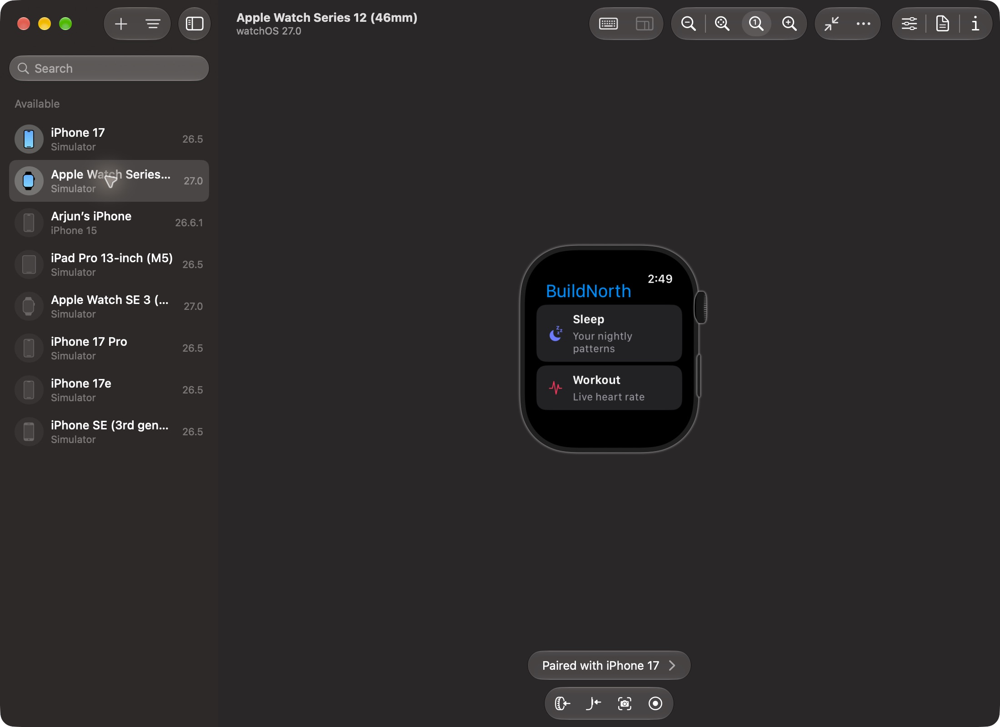
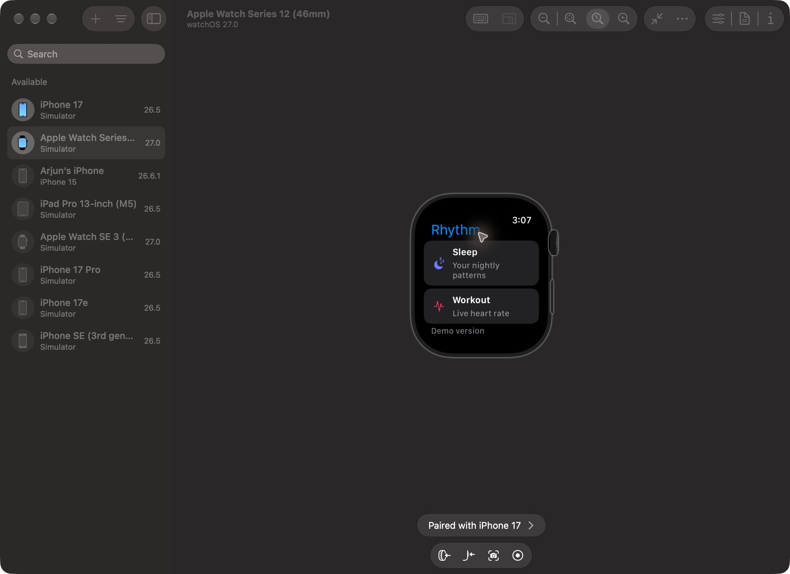

# Apple Watch UI validation — 25 October 2026

The Sleep/Workout implementation at `d843a88` on `codex/watch-sleep-workout` was
tested through Computer Use in the actual paired simulator UI. The requested
flows passed after correcting the supplied watch build and recovering a stalled
simulator service. No application source defect was confirmed during that run.

The full-flow screenshots show the **BuildNorth** name used by the tested commit.
A separate home screenshot below records the subsequent **Rhythm** integration
with `main`.

## Environment and scope

- iPhone 17, iOS 26.5, paired with Apple Watch Series 12 (46 mm), watchOS 27.0.
- Phone bundle: `com.arjun273773.buildnorth`; watch bundle:
  `com.arjun273773.buildnorth.watch`.
- Local API on port 8000 and Metro on port 8081 were running before testing.
  The API reported `aiProvider: none` and `aiAvailable: false`.
- Sleep data came from the Debug **Add sample sleep** action. Heart-rate values
  came from the simulator. No physical sensor or real sleep recording was tested.
- **Share health summaries with AI services** stayed off. Phone summary rows
  were marked **Not shared**.

## Observed results

| UI check | Result |
|---|---|
| Phone → watch sign-in | Tapped **Sign in Apple Watch** on the phone. The initial binary received the link but could not save it. After the signing repair below, the watch consumed the phone's queued link automatically and showed home. Sign-in also survived simulator restarts. |
| Home | Exactly two main navigation options: **Sleep** and **Workout**. |
| Sleep permissions and empty state | Completed the Health permission flow; before adding fixtures, Sleep showed **No sleep recorded for last night**. |
| Debug sample sleep | **Add sample sleep** populated today and yesterday, and uploaded their summaries. Today showed **6 h 25 min**, from **11:15 PM to 5:50 AM**. |
| Stages | Today showed Core **4 h 25 min**, Deep **55 min**, REM **1 h 5 min**, Awake **10 min**. Awake time was excluded from the asleep total. |
| Seven-night history | Today **6 h 25 min** and yesterday **6 h 45 min** appeared in the chart and rows. The other five nights stayed missing, represented by gaps/dashes rather than zero sleep. |
| Workout start and elapsed time | Starting a workout began the elapsed timer. Initially the screen showed a waiting-for-heart-rate explanation and missing metrics. |
| Navigation persistence | Returned home, visited Sleep, then reopened Workout. The same active workout and advancing elapsed time remained. Home indicated **Workout in progress**. |
| Pause and resume | Paused state showed **Resume**; two observations separated by over 20 seconds both showed **1:52**. Resuming restored the running timer and live reading. |
| Heart-rate presentation | Simulated readings populated live BPM, a line chart, average and peak. A resumed screen showed **58 BPM**; these observations validate UI/data handling only. |
| End and save | A fresh short session was ended with **End workout → End and save**. The UI showed **Workout ended**, **0:27**, and **Saved to Apple Health**, with average **60 BPM** and peak **62 BPM**. |
| Phone sync | Profile → Apple Watch showed the fictional sleep nights and available workout summaries: **2 min other · avg 60 bpm** and **1 min other · avg 60 bpm**. All rows remained **Not shared**. |
| Cleanup | Returned to the watch home. It showed **Sleep** and **Workout / Live heart rate**, with no active-workout indicator. |

## Environment issues and recovery

### Supplied simulator binary could not save the link

The watch displayed **Couldn't save the link from your iPhone**. The security log
reported error `-34018`: the client had neither `application-identifier` nor
`keychain-access-groups` entitlements. This was a build/signing issue, not evidence
of a token-storage implementation bug.

Rebuilt the unchanged watch source with simulator signing enabled, then installed
the result. From `mobile/`, with the generated iOS project already present:

```bash
xcodebuild -project ios/BuildNorth.xcodeproj -target watch \
  -configuration Debug -sdk watchsimulator \
  SYMROOT=/tmp/buildnorth-watch-check \
  CODE_SIGNING_ALLOWED=YES CODE_SIGN_IDENTITY=- build

xcrun simctl install <watch-udid> \
  /tmp/buildnorth-watch-check/Debug-watchsimulator/watch.app
```

The build succeeded and the watch then accepted the phone link. Do not disable
simulator signing for this keychain-dependent sign-in test.

### Simulator accessibility/display stalled

Device Hub became slow and eventually timed out during the workout test. A
process sample showed its main thread waiting on the watch simulator's
accessibility service. Reopening Device Hub and restarting the watch simulator
did not fully recover the display. Shutting down the paired simulators,
restarting the CoreSimulator service, and starting the pair again restored it.

The interrupted session was not used as proof of successful saving. The fresh
27-second session above verified the end/save path after recovery. This does not
establish workout recovery after force-quit or simulator restart; the app only
promises persistence while navigating within the running app.

## Checks and limits

Run from `mobile/`:

```bash
npm run lint
npm run typecheck
bash scripts/check-watch-models.sh
```

All passed. The watch script reported **174 checks passed**, followed by successful
typechecking of `targets/watch` for watchOS 11. The signed Debug watch simulator
build also succeeded. Backend suites and physical-device tests were not rerun as
part of this UI session; older results in the work log are separate evidence.

Real heart-rate accuracy, sensor contact, overnight sleep acquisition, and
physical-device performance remain unverified. The Health permission grant path
was exercised; this report does not claim coverage of every denial/revocation
combination. AI sharing was left off, so this session did not exercise AI or
Agent Memory delivery.

## Screenshots

The PNGs below are unmodified Computer Use captures. They contain fictional
simulator health data and can be opened at full resolution.

| Screen | Evidence |
|---|---|
| Final two-option home | [Home](assets/watch-ui-2026-10-25/home.png) |
| Sleep empty state | [Empty state](assets/watch-ui-2026-10-25/sleep-empty.png) |
| Sleep duration | [Duration](assets/watch-ui-2026-10-25/sleep-duration.png) |
| Core / Deep and REM / Awake | [Core and Deep](assets/watch-ui-2026-10-25/sleep-core-deep.png), [REM and Awake](assets/watch-ui-2026-10-25/sleep-rem-awake.png) |
| Seven-night chart | [History](assets/watch-ui-2026-10-25/sleep-history.png) |
| Paused timer | [Paused](assets/watch-ui-2026-10-25/workout-paused.png) |
| Resumed live reading | [Resumed](assets/watch-ui-2026-10-25/workout-resumed.png) |
| Saved workout and metrics | [Saved](assets/watch-ui-2026-10-25/workout-saved.png) |
| AI sharing off | [Sharing setting](assets/watch-ui-2026-10-25/sharing-off.png) |
| Phone summaries | [Phone sync](assets/watch-ui-2026-10-25/phone-sync.png) |



## Integration with main and pre-merge verification

After the UI run, the user requested committing, pushing and merging this work
into `main`. Integrated `origin/main` at `95aed5e`, retaining its Rhythm branding
and demo labels while keeping the two-option watch navigation, Sleep/Workout
permission text, and `workout-processing` background mode. The removed legacy
Today and Health screens remain removed.

The new home initially placed the demo label over the Workout subtitle. Moving
the label into a list section footer fixed the overlap. Rebuilt and installed the
signed watch app, opened it through Computer Use, and confirmed the persisted
sign-in, Rhythm title, exactly two main options, readable demo footer, and no
active-workout indicator. Left the watch on this home screen. This was a home
smoke check; the complete Sleep/Workout flows above were run at `d843a88`.

Checks on the integrated tree all passed:

- `npm run lint` and `npm run typecheck`.
- `bash scripts/check-watch-models.sh`: 174 model checks and watchOS 11
  typechecking, rerun after the footer correction.
- `node --experimental-strip-types --test src/lib/watch-link.test.mjs src/lib/health-sharing.test.mjs`:
  13 phone-link and sharing-copy tests. Node 23.5 required the explicit type
  stripping flag; running without it failed to load the TypeScript imports.
- From `mobile/backend/`, `.venv/bin/python -m pytest -q tests/test_watch.py`:
  54 passed.
- Signed Debug watch simulator build using the command above with
  `SYMROOT=/tmp/buildnorth-watch-merge-check`, rerun after the footer correction.
- `git diff --check` and documentation image-link checks.

The unrelated untracked `.claude/launch.json` was not modified or committed.
The full backend suite and physical-device tests were not run for this integration.


